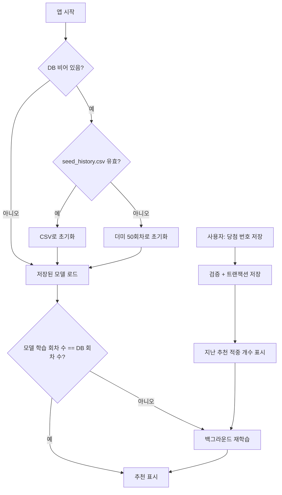

# 로또 6/45 오프라인 번호 추천 앱

인터넷 연결 없이 안드로이드 기기 안에서만 동작하는 로또 6/45 번호 추천 앱입니다.
누적된 과거 당첨 번호로 1~45 각 번호의 "다음 회차 출현 점수"를 학습하고, 매주 사용자가 입력하는
실제 당첨 번호를 반영해 기기 안에서 모델을 다시 학습합니다.

> 로또 추첨은 독립적인 무작위 시행입니다. 이 앱의 추천은 과거 통계를 반영한 가중 무작위 추출일 뿐,
> 당첨 확률을 높여 주지 않습니다.

---

## 1. 파일 구성

| 파일 | 역할 |
| --- | --- |
| `main.py` | Kivy UI (추천 탭, 당첨 번호 입력/관리 탭), 앱 시작·재학습 흐름 제어 |
| `storage.py` | SQLite 저장소. 당첨 이력·추천 이력 테이블, 입력 검증, 초기 데이터(Seed) |
| `ml_engine.py` | Feature 생성, 모델 학습/저장/로드, 점수 정규화, 5게임 추천 |
| `buildozer.spec` | 안드로이드 APK 빌드 설정 |
| `requirements.txt` | PC(Windows 등) 개발·테스트용 패키지 목록 |
| `seed_history.csv` | (선택) 실제 과거 당첨 번호. 있으면 최초 실행 시 더미 대신 사용 |
| `fonts/Pretendard-*.otf` | 번들 한글 폰트 (Regular / SemiBold / Bold), `Pretendard-LICENSE.txt`(OFL) 포함 |
| `assets/icon.png` | 앱 아이콘 (512×512) |
| `assets/presplash.png` | 안드로이드 시작 화면 |
| `assets/tab_*.png` | 하단 탭 아이콘 (흰색으로 그려서 앱에서 색을 입힘) |
| `tools/make_assets.py` | 위 PNG를 다시 만드는 개발용 스크립트 (Pillow 필요, APK에서 제외) |

### 실행 중 생성되는 파일

앱 전용 데이터 폴더(`App.user_data_dir`)에 저장됩니다.

| 환경 | 위치 |
| --- | --- |
| Windows | `%APPDATA%\lotto\` |
| Android | 앱 내부 저장소 (설정 → 앱 → 저장공간 → 데이터 삭제 시 초기화) |

| 파일 | 내용 |
| --- | --- |
| `lotto.db` | SQLite DB (당첨 이력, 추천 이력) |
| `lotto_model.json` | 학습된 모델 (xgboost는 네이티브 JSON, sklearn/numpy는 JSON 래퍼) |
| `lotto_model.meta.json` | 모델 메타데이터 (백엔드 종류, 학습 회차 수, 학습 시각 등) |

---

## 2. 전체 동작 흐름



---

## 3. 로컬 데이터베이스 (`storage.py`)

### `draw_history` — 당첨 이력

| 컬럼 | 타입 | 설명 |
| --- | --- | --- |
| `draw_no` | INTEGER PK | 회차 번호 |
| `n1` ~ `n6` | INTEGER | 당첨 번호 6개 (오름차순 저장) |
| `bonus` | INTEGER NULL | 보너스 번호 (선택) |
| `created_at` | TIMESTAMP | 등록 시각 |

### `recommendations` — 추천 이력

| 컬럼 | 타입 | 설명 |
| --- | --- | --- |
| `id` | INTEGER PK AUTOINCREMENT | |
| `target_draw_no` | INTEGER | 추천 대상 회차 |
| `games_json` | TEXT | 5게임 JSON 배열 (예: `[[3,12,18,25,33,41], ...]`) |
| `created_at` | TIMESTAMP | 생성 시각 |

### 입력 검증 규칙 (`validate_draw`)

- 회차: 1 이상의 정수, 이미 등록된 회차는 거부
- 당첨 번호: 정확히 6개, 모두 1~45, 서로 중복 없음
- 보너스: 비워도 됨. 입력하면 1~45이고 당첨 번호 6개와 겹치지 않아야 함

### 주요 메서드

| 메서드 | 설명 |
| --- | --- |
| `add_draw(draw_no, numbers, bonus)` | 검증 → 중복 회차 확인 → 트랜잭션 저장. 실패 시 `ValidationError` |
| `get_draw(draw_no)` | 특정 회차 조회 |
| `list_draws(limit, descending)` | 회차 목록 조회 |
| `get_number_matrix()` | ML용 회차 오름차순 번호 행렬 |
| `save_recommendation` / `latest_recommendation` | 추천 이력 저장/조회 |

SQLite 연결은 작업마다 새로 열기 때문에 백그라운드 학습 스레드에서도 안전하게 읽을 수 있습니다.

---

## 4. ML 파이프라인 (`ml_engine.py`)

### Feature (번호 1~45 각각, 회차 t 직전까지의 데이터만 사용)

| Feature | 의미 |
| --- | --- |
| `recent_freq_5` | 최근 5회차 출현 횟수 |
| `recent_freq_10` | 최근 10회차 출현 횟수 |
| `recent_freq_20` | 최근 20회차 출현 횟수 |
| `cycles_since_last` | 마지막 출현 이후 연속 미출현 회차 수 |
| `total_freq_ratio` | 전체 회차 대비 출현 비율 |

- 학습 샘플: 11번째 회차부터 각 회차 × 45개 번호 (라벨 = 그 회차에 출현했으면 1, 아니면 0)
- 회차 t의 Feature는 t 이전 회차로만 계산하므로 미래 정보가 학습에 섞이지 않습니다.
- 예측: 전체 이력으로 계산한 "다음 회차" Feature를 모델에 넣어 45개 점수를 얻습니다.

### 모델 백엔드 (한 줄 스위치)

`ml_engine.py` 상단:

```python
MODEL_BACKEND = "xgboost"
# MODEL_BACKEND = "sklearn"
# MODEL_BACKEND = "numpy"
```

| 백엔드 | 모델 | 비고 |
| --- | --- | --- |
| `xgboost` | XGBoost 네이티브 API, 트리 40개, `max_depth=3`, `tree_method='hist'` | PC 기본값 |
| `sklearn` | `HistGradientBoostingClassifier(max_iter=40, max_depth=3)` | xgboost NDK 빌드 실패 시 대체 |
| `numpy` | 순수 numpy L2 로지스틱 회귀 | 추가 의존성 없음, APK 기본 |

선택한 백엔드를 import할 수 없거나 학습 중 실패하면 `xgboost → sklearn → numpy` 순서로 자동 폴백합니다.
저장된 모델은 메타 파일에 기록된 백엔드로 다시 로드합니다.

### 추천 생성

1. 45개 점수를 Z-score로 표준화한 뒤 Softmax(`SOFTMAX_TEMPERATURE = 1.5`)로 확률 가중치 변환
   - 온도를 낮추면 고득점 번호에 집중, 높이면 균등에 가까워짐
   - `NORMALIZATION = "minmax"`로 바꾸면 Min-Max 가중치 사용
2. 가중치 기반 비복원 추출로 6개 선택 → 오름차순 정렬
3. 서로 다른 조합 5게임이 될 때까지 반복, `recommendations` 테이블에 저장

### 백그라운드 재학습

- `retrain_async()`가 `threading.Thread`(daemon)에서 학습하므로 UI가 멈추지 않습니다.
- 학습 중 또 저장 요청이 오면 현재 학습이 끝난 직후 한 번 더 학습합니다.
- 모델은 임시 파일에 먼저 쓰고 `os.replace`로 교체하므로 저장 도중 앱이 종료돼도 기존 모델이 보존됩니다.
- 첫 학습이 끝나기 전에는 출현 빈도 기반 임시 점수로 추천하고, 학습이 끝나면 자동으로 다시 추천합니다.

---

## 5. UI (`main.py`)

순수 Kivy로 구현했습니다 (KivyMD는 버전 간 API 변경이 커서 사용하지 않음).
밝은 테마(회색 배경 `#F2F4F6` + 흰 둥근 카드 + 주 색상 `#3182F6`)이며, 색상은 `main.py`의 KV 상단
`#:set C_...` 값에서 한 번에 바꿀 수 있습니다. PC에서 실행하면 휴대폰 비율(400×820) 창으로 뜹니다.

### 화면 크기 / 글자 크기 대응
- 화면 폭이 560dp(`LottoApp.max_content_width`)보다 넓으면(예: 폴드 펼침 화면, 태블릿) 콘텐츠를
  560dp 폭으로 가운데 정렬합니다. 좁은 화면에서는 폭 전체를 사용합니다.
- 추천 카드의 로또 공은 카드 폭에 맞춰 22~42dp 사이에서 자동으로 크기가 바뀝니다.
- 글자를 담는 영역의 높이는 `sp` 또는 실제 글자 높이 기준이라, 안드로이드 시스템 글자 크기를
  키우면 영역도 함께 커져서 글자가 잘리지 않습니다.
- PC에서 글자 크기 설정을 흉내 내려면 `$env:KIVY_METRICS_FONTSCALE="1.3"; python main.py`로 실행합니다.

### 공통 레이아웃
- 상단 헤더: 앱 이름 `로또 6/45` + 상태 칩 (`xgboost · 학습 완료` / 주황색 `● 학습 중`)
- 하단 탭 바: `번호 추천`, `당첨 번호 관리` (선택된 탭은 진한 색)

### 번호 추천 탭
- `다음 회차 · N회` + `이번 주 추천 번호` 제목, 학습에 쓴 회차 수 안내
- 5게임(A~E)을 그림자가 있는 흰 카드에 로또 공으로 표시 (화면 폭에 맞춰 공 크기 자동 조절)
  - 1~10 노랑, 11~20 파랑, 21~30 빨강, 31~40 회색, 41~45 초록 (동행복권 색상)
- 하단 고정 `[새로운 5게임 추천받기]` 버튼

### 당첨 번호 관리 탭 (화면 전체 스크롤)
- `당첨 번호 등록` 카드
  - 회차 (최신 회차 + 1 자동 입력) + 보너스(선택) + 당첨 번호 6칸
  - 숫자 키보드, 칸당 최대 2자리, 입력 중인 칸은 파란 테두리
  - `[당첨 번호 저장 및 모델 재학습]` 버튼
  - 결과 메시지: 오류(빨강) / 저장 완료 + 지난 추천 적중 개수 + 재학습 결과(초록)
- `등록된 회차` 카드: 전체 회차 수 + 최근 30회 목록 (`main.py`의 `HISTORY_LIMIT`로 조절)

### 한글 폰트
Kivy 기본 폰트에는 한글이 없어서 시작 시 기본 폰트 자체를 교체합니다.

1. 번들된 Pretendard (`fonts/Pretendard-Regular/SemiBold/Bold.otf`) — 본문, 강조, 굵은 글씨
2. 없으면 시스템 한글 폰트: 안드로이드 `NotoSansCJK`, Windows 맑은 고딕, macOS, Linux 순

### 아이콘 / 시작 화면
`buildozer.spec`의 `icon.filename`, `presplash.filename`에 연결되어 있습니다.
디자인을 바꾸려면 `tools/make_assets.py`를 수정한 뒤 `python tools/make_assets.py`로 다시 생성하세요.

---

## 6. 기존(과거) 당첨 번호 입력 방법

최초 실행 시 DB가 비어 있으면 **1~50회차의 더미(무작위) 데이터**가 자동으로 들어갑니다.
실제 회차 번호(예: 1190회)와 겹치지 않으므로, 실제 데이터를 입력해도 더미 데이터가 학습에 계속 섞입니다.
**실제 과거 데이터를 쓰려면 아래 방법 A(CSV로 초기화)를 권장합니다.**

### 방법 A — `seed_history.csv`로 초기화 (권장, 대량 입력)

#### 1) CSV 파일 준비

프로젝트 폴더(`main.py`와 같은 위치)에 `seed_history.csv`를 만듭니다.

```csv
draw_no,n1,n2,n3,n4,n5,n6,bonus
1150,8,9,18,35,39,45,25
1151,2,3,9,15,27,29,8
1152,30,31,32,35,36,37,5
```

> 위 숫자는 형식 예시이며 실제 당첨 번호가 아닙니다.

형식 규칙:

| 항목 | 규칙 |
| --- | --- |
| 열 순서 | `회차, 번호1, 번호2, 번호3, 번호4, 번호5, 번호6, 보너스` |
| 구분자 | 쉼표, 탭(Excel에서 복사해 붙여넣기), 세미콜론, 공백 모두 가능 |
| 헤더 | 있어도 되고 없어도 됨 (첫 칸이 숫자가 아닌 줄과 `#` 주석 줄은 건너뜀) |
| 회차 중복 | 같은 회차가 두 번 나오면 잘못된 행으로 처리 |
| 번호 순서 | 상관없음 (저장 시 자동 오름차순 정렬) |
| 보너스 | 비워도 됨 (`1150,8,9,18,35,39,45,` 또는 7열까지만) |
| 행 순서 | 상관없음 (학습 시 회차 번호 순으로 정렬) |
| 인코딩 | UTF-8 (BOM 포함 가능). Excel에서는 "CSV UTF-8(쉼표로 분리)"로 저장 |
| 분량 | Feature가 최근 20회차를 보므로 최소 30회차, 가능하면 100회차 이상 권장 |

실제 당첨 번호는 동행복권 홈페이지의 회차별 당첨번호 조회 화면에서 엑셀로 내려받을 수 있습니다.
내려받은 파일에서 위 열 순서대로 정리한 뒤 CSV로 저장하세요.

> **주의:** CSV 안에 잘못된 행이 **하나라도** 있으면(범위 밖 번호, 중복 번호, 보너스 중복, 칸 부족 등)
> CSV 전체가 무시되고 **아무 표시 없이** 더미 데이터로 초기화됩니다.
> 실행 후 당첨 번호 관리 탭의 이력 목록이 1~50회가 아니라 CSV의 회차로 보이는지 꼭 확인하세요.

#### 2) 기존 데이터 삭제 후 재실행 (PC)

CSV는 **DB가 비어 있을 때만** 읽힙니다. 이미 앱을 실행한 적이 있다면 데이터 폴더를 지워야 합니다.

```powershell
# 앱을 종료한 상태에서
Remove-Item "$env:APPDATA\lotto\lotto.db", "$env:APPDATA\lotto\lotto_model*.json" -ErrorAction SilentlyContinue
.\.venv\Scripts\Activate.ps1
python main.py
```

실행하면 CSV로 DB가 채워지고, 백그라운드에서 모델이 새로 학습됩니다.

#### 3) 안드로이드에 적용

`buildozer.spec`의 `source.include_exts`에 `csv`가 포함되어 있으므로, 프로젝트 폴더에
`seed_history.csv`를 둔 채 빌드하면 APK에 함께 들어갑니다.

- 처음 설치하는 기기: 첫 실행 시 자동으로 CSV 데이터가 들어갑니다.
- 이미 설치되어 있던 기기: 설정 → 앱 → Lotto Offline → 저장공간 → **데이터 삭제** 후 실행합니다.
  (기존에 입력한 당첨 번호와 추천 이력도 함께 지워집니다.)

### 방법 B — 앱 화면에서 한 회차씩 입력 (매주 입력)

매주 추첨 후 새 당첨 번호를 넣는 기본 방법입니다.

1. 하단 **당첨 번호 관리** 탭으로 이동
2. **회차** 확인 (최신 회차 + 1이 자동으로 채워져 있음, 필요하면 수정)
3. **당첨 번호 6칸**에 번호 입력 (순서 상관없음)
4. **보너스** 입력 (선택)
5. **[이번 주 당첨 번호 저장 및 모델 재학습]** 클릭

저장되면:
- 그 회차에 앱이 추천했던 5게임의 적중 개수가 표시됩니다. 예: `[지난 추천 적중 A:0 B:1 C:2 D:1 E:0]`
- 백그라운드 재학습이 끝나면 추천 탭이 다음 회차 추천으로 자동 갱신됩니다.

과거 회차를 하나씩 넣을 때도 회차 칸만 바꿔 같은 방식으로 입력할 수 있습니다.
저장할 때마다 재학습하지만 학습이 1초 미만이라 연속으로 입력해도 문제없습니다.

### 방법 C — 기존 DB를 유지한 채 CSV 일괄 추가 (PC)

이미 입력한 데이터를 지우지 않고 과거 회차를 한꺼번에 추가하려면, 앱을 종료한 상태에서
프로젝트 폴더에서 아래 스크립트를 실행합니다. 이미 있는 회차나 잘못된 행은 건너뛰고 이유를 출력합니다.

```python
# import_history.py
import csv
import os

from storage import LottoStorage, ValidationError

db = os.path.join(os.environ["APPDATA"], "lotto", "lotto.db")
storage = LottoStorage(db)

added = 0
with open("seed_history.csv", newline="", encoding="utf-8-sig") as f:
    for row in csv.reader(f):
        if not row or not row[0].strip().isdigit():
            continue
        try:
            storage.add_draw(row[0], row[1:7], row[7] if len(row) > 7 else None)
            added += 1
        except ValidationError as exc:
            print(f"건너뜀 {row[0]}회: {exc}")
print(f"{added}개 회차 추가 완료")
```

```powershell
.\.venv\Scripts\Activate.ps1
python import_history.py
python main.py   # 시작 시 DB 회차 수가 바뀐 것을 감지해 자동 재학습
```

> 이 방법은 DB에 이미 있는 1~50회 더미 데이터를 지우지 않습니다. 더미 데이터를 빼려면 방법 A를 사용하세요.

---

## 7. 실행 및 빌드

### PC에서 실행 (Python 3.11 권장)

```powershell
python -m venv .venv
.\.venv\Scripts\Activate.ps1
pip install -r requirements.txt
python main.py
```

Python 설치 직후 `python`을 찾지 못하면 터미널(또는 Cursor)을 새로 열어 PATH를 다시 읽게 하세요.

### 안드로이드 APK 빌드 — GitHub Actions (PC에 Linux가 없을 때)

`.github/workflows/build-apk.yml`이 GitHub 서버(Ubuntu)에서 buildozer로 APK를 만듭니다.

1. GitHub에 비공개(private) 저장소를 만들고 프로젝트 파일을 올립니다 (`.venv`, `__pycache__`, `data.xlsx` 제외).
2. `main` 브랜치에 올라가면 자동으로 빌드가 시작됩니다. 수동 실행은 **Actions → Build Android APK → Run workflow**.
3. 첫 빌드는 SDK/NDK 다운로드 때문에 30~60분, 이후에는 캐시로 더 빨라집니다.
4. 완료된 실행 화면 하단 **Artifacts**의 `lotto-offline-apk`(zip)를 내려받아 압축을 풀면 APK가 있습니다.

### 안드로이드 APK 빌드 (Linux 또는 WSL)

```bash
pip install buildozer
buildozer android debug
```

`buildozer.spec`의 기본 `requirements`는 `python3,kivy==2.3.0,numpy`입니다.
python-for-android에는 xgboost 레시피가 없어서, APK에서는 자동으로 numpy 백엔드로 폴백합니다.
sklearn을 쓰려면 spec 파일의 주석 처리된 `requirements` 줄과 `MODEL_BACKEND = "sklearn"`을 함께 바꾸세요.

앱은 어떤 안드로이드 권한(인터넷 포함)도 요청하지 않습니다.
